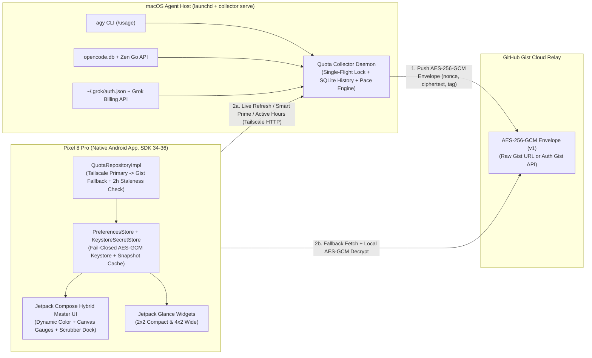
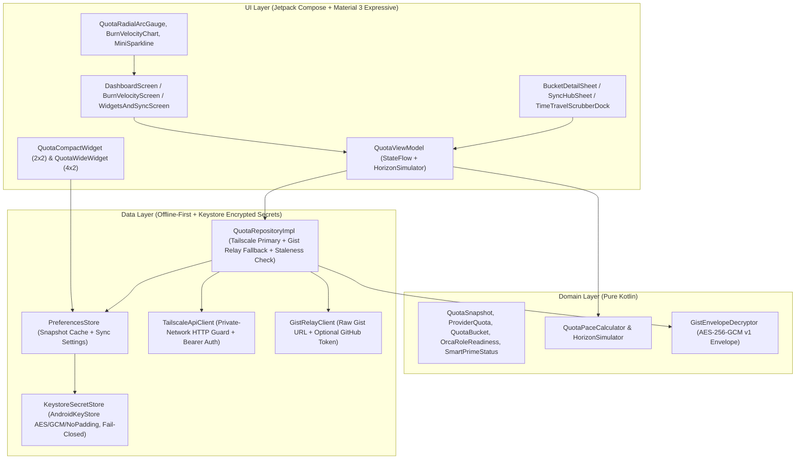

# Architectural Plan & Delivery Roadmap — AI Quota Monitor

## 1. Vision & Quality Bar

Build a **native Android application** (Kotlin + Jetpack Compose, **Material You Dynamic Color + Material 3 Expressive**, zero WebViews) tailored for the **Pixel 8 Pro** (120Hz LTPO OLED, edge-to-edge, Predictive Back) that gives instant, high-signal visibility into AI model quotas across the active coding-agent subscriptions (`agy` / Antigravity, `opencode go`, and `grok` Build CLI).

Key pillars:
- **100% Native Android (Zero WebViews)**: Material You Dynamic Color adapting to the Pixel 8 Pro wallpaper palette, Material 3 Expressive shapes (`28dp` squircle hero cards) and spring physics, custom Compose `Canvas` progress arcs with linear pace markers (`QuotaRadialArcGauge`), bezier sparkline burn-rate charts, and native **Jetpack Glance Home-Screen Widgets (`2x2` & `4x2`)**.
- **Dual-Path Transport (Tailscale Live Refresh + AES-256-GCM Encrypted Cloud Relay)**:
  - **Primary Live Path (Tailscale)**: When the Mac host is reachable over Tailscale (`100.64.0.0/10` / `*.ts.net`, requiring the Tailscale Android app with VPN active on the Pixel 8 Pro), the app queries the Mac Collector daemon directly (`GET /v1/quota`, `POST /v1/quota/refresh`, `POST /v1/grok/prime`, `POST /v1/config/active-hours`, `GET /v1/history`).
  - **Always-Available Fallback (AES-256-GCM Encrypted Gist Relay)**: Every periodic or manual collection cycle on the Mac encrypts the normalized snapshot with **AES-256-GCM** (random 96-bit nonce + 128-bit authentication tag providing both confidentiality and authenticated integrity) and publishes `quota_snapshot.enc.json` to a GitHub Gist.
  - **GitHub Gist Access Model (Post-Sept 2025 API Rules)**: Because GitHub's REST API (`GET https://api.github.com/gists/{id}`) returns `401` for unauthenticated secret-gist reads since Sept 2025 and caps anonymous API calls at `60/hr`, the Android `GistRelayClient` supports:
    1. **Direct Raw Gist URL** (`https://gist.githubusercontent.com/<user>/<gist_id>/raw/quota_snapshot.enc.json`), which works without a GitHub token on the phone and avoids the `60/hr` REST API limit, OR
    2. **Gist ID + Optional GitHub Fine-Grained Read Token** (encrypted at rest in Android Keystore) for authenticated `GET https://api.github.com/gists/{id}`.
    Because unlisted gists are reachable by URL and scanned by GitHub, all secrecy rests on the 256-bit AES-GCM key (which never touches GitHub), and the collector scrubs `host` to `"collector"` rather than leaking `socket.gethostname()`.
- **Unified Smart Prime Lifecycle for Grok**:
  - When the Grok OAuth token (`~/.grok/auth.json`) is expired (`<= 0s`) or near expiry (`< 900s` / 15m), the collector executes `/opt/homebrew/bin/grok -p "reply with ok"` **only** during configured active working hours (`08:00–22:00`, synced from the Android app via `POST /v1/config/active-hours`) **or** when triggered by an explicit pull-to-refresh (`manual_refresh=True`) or manual **Prime Pulse** (`POST /v1/grok/prime`, `force=True`).
- **Prototype-First via Google Stitch**: Visual language codified in [`.stitch/DESIGN.md`](../.stitch/DESIGN.md) and explored across 3 distinct aesthetic sets (`Conservative`, `Modern`, `Avant-Garde`) before converging on the **Hybrid Master Fusion**.
- **Public-Repo Safe from Commit #1**: Pre-commit hooks (`.githooks/pre-commit`), automated repo hygiene unit tests, and externalized credentials ensure zero secrets, tokens, personal emails, or `/Users/<username>` paths ever enter Git history.
- **Multi-Agent Orca Orchestration**:
  - **Planning & Architecture**: `agy` with `gemini-4-argon-high` (Gemini 4 Argon High)
  - **Implementation & Testing**: `agy` with `gemini-3.8-flash-high` (Gemini 3.8 Flash High)
  - **Code & Plan Review**: `grok` CLI with `grok-4.7` (`--effort medium`)

---

## 2. Resolved Architectural Decisions (Owner Aligned)

| # | Decision Area | Locked-In Architecture |
| :--- | :--- | :--- |
| **1** | **Data Transport** | **Mac Collector + Encrypted Gist Relay + Tailscale Live Refresh**. Collector runs on macOS (`launchd` daemon `com.aiquotamonitor.collector.plist` + background poll loop inside `collector serve`), serves authenticated HTTP on Tailscale/loopback with a single-flight lock, and publishes AES-256-GCM encrypted snapshots to GitHub Gist for offline-Mac resilience. |
| **2** | **Subscription Scope (v1)** | **Baseline Trio**: `agy` (Antigravity: Gemini 4 Argon, Gemini 3.8 Flash, Claude/GPT 3P), `opencode go` (DeepSeek 4.1 Flash — rolling/weekly/monthly), and `grok` (Grok Build CLI — Grok 4.7 weekly credits + on-demand/prepaid metadata). |
| **3** | **Grok Token Priming** | **Smart Prime**: Primes expired or `<15m` tokens during active hours (`08:00–22:00`) or on explicit manual refresh; `POST /v1/grok/prime` forces an immediate prime and returns the full canonical `QuotaSnapshot`. Active hours are configurable in-app and synced to the Mac collector via `POST /v1/config/active-hours`. |
| **4** | **Android Surfaces & Intelligence** | **Hybrid Master Dashboard** (`OrcaRoleReadinessStrip`, `HeroBottleneckCard` with `QuotaRadialArcGauge` & Target Pace Notch, `ProviderBentoRow`, `AntigravityBucketsCard`, persistent `TimeTravelScrubberDock` with `NOW → +1H → +4H → RESET`) + **`BucketDetailSheet` & `SyncHubSheet` Modal Bottom Sheets** + **Burn Velocity Tab** + **Native Jetpack Glance Home-Screen Widgets (`2x2` & `4x2`)**. |
| **5** | **Visual Design Direction** | **Material You Dynamic Color + Material 3 Expressive**: Adapts dynamically to the Pixel 8 Pro system wallpaper palette (`dynamicDarkColorScheme` / `dynamicLightColorScheme`) paired with semantic status tokens (`#5CE196` Healthy, `#FFB951` Warning, `#FFB4AB` Critical) and tabular numerals (`tnum`). |
| **6** | **Stitch MCP Integration** | **Stitch API Key (`X-Goog-Api-Key`)** configured in `~/.gemini/config/mcp_config.json` (outside the git repo). |

---

## 3. System & Android Architecture

### 3.1 End-to-End Data Flow

### 3.2 Native Android App Architecture (Clean Architecture + UDF)

### 3.3 Key Technical Stack & Security Boundaries
- **Language & Build**: Kotlin 2.1, Gradle Version Catalog (`gradle/libs.versions.toml`), Android Gradle Plugin `8.8.2`, Compose Compiler plugin, Kotlinx Serialization.
- **SDK Targets**: `minSdk = 34` (Android 14 — Pixel 8 Pro baseline), `compileSdk = 36`, `targetSdk = 36` (Android 16), full **edge-to-edge** (`enableEdgeToEdge()`) and **back handling** (`BackHandler` for sheets and secondary tabs).
- **UI & Widgets**: Jetpack Compose + Material 3 (`dynamicDarkColorScheme` / `dynamicLightColorScheme`), spring physics (`Spring.DampingRatioMediumBouncy`), custom `Canvas` gauges, and `androidx.glance:glance-appwidget` (`2x2` and `4x2` responsive widgets updated via `updateAll` on every snapshot or polarity change).
- **Security, Network & Signing**:
  - **Fail-Closed Android Keystore (`KeystoreSecretStore`)**: Encrypts the Tailscale bearer token, AES-256-GCM relay key, and optional GitHub read token via `AndroidKeyStore` (`AES/GCM/NoPadding`). On Android devices, cipher/Keystore failures fail closed (never writing plaintext secrets to `SharedPreferences`); an ephemeral in-memory AES key is used strictly when `AndroidKeyStore` provider is absent in host JVM unit tests.
  - **Private-Network Cleartext Guard**: `network_security_config.xml` and `TailscaleApiClient` restrict `http://` traffic to private/Tailscale/loopback addresses (`100.64.0.0/10`, `127.0.0.1`, `localhost`, `10.0.0.0/8`, `192.168.0.0/16`, `*.ts.net`) and require `https://` for any other host, preventing accidental bearer-token transmission over public cleartext HTTP.
  - **Snapshot Freshness Check**: Snapshots older than 2 hours (`7200s`) are flagged as stale in `ConnectionState` and the UI status pill so old relay snapshots are never mistaken for live readings.
  - **Signing Configuration**: `app/build.gradle.kts` supports release signing via environment variables (`SIGNING_STORE_FILE`, `SIGNING_STORE_PASSWORD`, `SIGNING_KEY_ALIAS`, `SIGNING_KEY_PASSWORD`) in `release.yml`, falling back cleanly to debug signing for local builds and PR checks.

---

## 4. Phased Delivery Status

- **Phase 0: Environment, Skills, Docs & Stitch Setup** — **Complete** (29 skills installed in `.agents/skills/`, OpenJDK 21 + Android SDK 35/36 + `android` CLI installed, `.githooks/pre-commit` active).
- **Phase 1: Google Stitch UI/UX Prototype & `.stitch/DESIGN.md`** — **Complete** (Generated 3 Conservative + 3 Modern + 3 Avant-Garde + 1 Hybrid Master screen in Stitch project `projects/8157070654946262217`).
- **Phase 2: Mac Companion Collector + Encrypted Cloud Relay** — **Complete** (`collector/` with SQLite `0600` history DB, single-flight lock, background poll + Gist publish loop, `launchd` plist template, fail-closed parsers, and cross-language AES-256-GCM envelope).
- **Phase 3: Native Android App & Glance Widgets** — **Complete** (`app/` with Hybrid Master UI, `TimeTravelScrubberDock` `NOW → +1H → +4H → RESET`, `BucketDetailSheet`, `SyncHubSheet`, `KeystoreSecretStore`, `QuotaCompactWidget` `2x2` & `QuotaWideWidget` `4x2`).
- **Phase 4 & 5: Cross-System Review, CI/CD & Device Readiness** — **Complete** (Reviewed by `grok-4.7 --effort medium`, backed by `.github/workflows/ci.yml` running collector unit tests + `./gradlew lintDebug testDebugUnitTest assembleDebug` and `.github/workflows/release.yml`).
