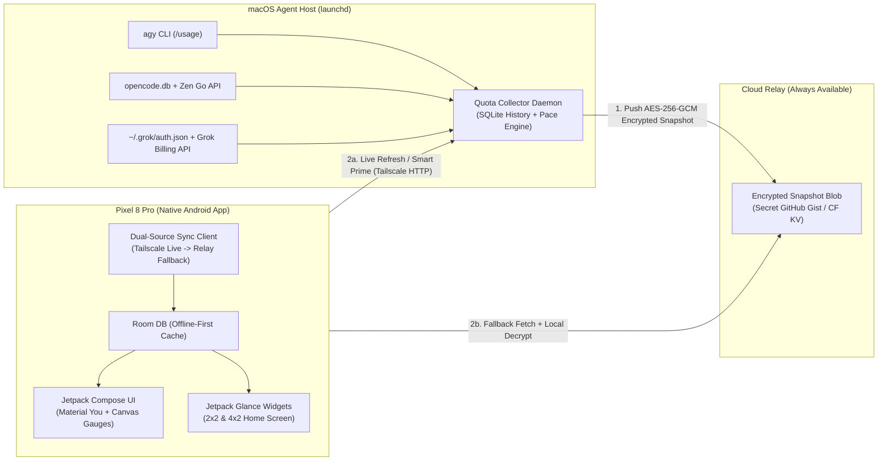
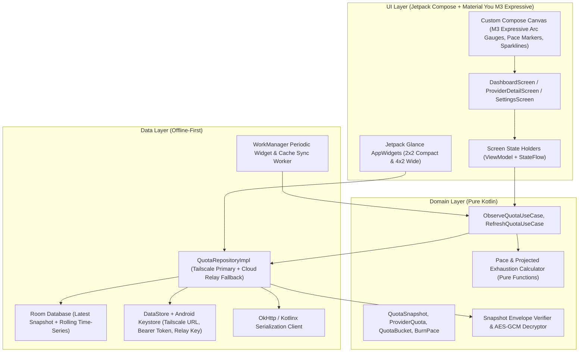

# Architectural Plan & Delivery Roadmap — AI Quota Monitor

## 1. Vision & Quality Bar

Build a **native Android application** (Kotlin + Jetpack Compose, **Material You Dynamic Color + Material 3 Expressive**, zero WebViews) tailored for the **Pixel 8 Pro** (120Hz LTPO OLED, edge-to-edge, Predictive Back) that gives instant, high-signal visibility into AI model quotas across the active coding-agent subscriptions (`agy` / Antigravity, `opencode go`, and `grok` Build CLI).

Key pillars:
- **100% Native Android (Zero WebViews)**: Material You Dynamic Color adapting to the Pixel 8 Pro wallpaper palette, Material 3 Expressive shapes and spring physics, custom Compose `Canvas` progress arcs with linear pace markers, sparkline burn-rate charts, and native **Jetpack Glance Home-Screen Widgets (`2x2` & `4x2`)**.
- **Dual-Path Transport (Cloud Relay + Tailscale Live Refresh)**:
  - **Primary Live Path (Tailscale)**: When the Mac host is reachable over Tailscale, the Pixel 8 Pro hits the Mac Collector daemon directly (`/v1/quota`, `/v1/quota/refresh`, `/v1/history`) for real-time refresh and on-demand Grok token priming.
  - **Always-Available Fallback (Encrypted Cloud Relay)**: Every Mac collection cycle pushes an AES-256-GCM encrypted & signed snapshot + rolling history payload to a Cloud Relay (e.g., a secret GitHub Gist using the host's `gist` scope or Cloudflare KV). Even if the Mac is asleep or unreachable, the Pixel 8 Pro can always fetch and decrypt the latest snapshot.
- **Smart Prime Policy for Grok**:
  - `grok -p "reply with ok"` token priming runs **only** on manual pull-to-refresh or during configured active working hours when the token is within 15 minutes of expiry—never waking sessions or burning credits during idle/overnight background polls.
- **Prototype-First via Google Stitch**: Pin down the visual language (`.stitch/DESIGN.md`) and every screen in **Google Stitch** (connected via `X-Goog-Api-Key`) before writing UI code.
- **Public-Repo Safe from Commit #1**: Pre-commit hooks (`.githooks/pre-commit`), automated repo hygiene unit tests, and externalized credentials ensure zero secrets, tokens, or personal identifiers ever enter Git history.
- **Multi-Agent Orca Orchestration**:
  - **Planning & Architecture**: `agy` with `gemini-4-argon-high` (Gemini 4 Argon High)
  - **Implementation & Testing**: `agy` with `gemini-3.8-flash-high` (Gemini 3.8 Flash High)
  - **Code Review**: `grok` CLI with `grok-4.7` (`--effort medium`)

---

## 2. Resolved Architectural Decisions (Owner Aligned)

| # | Decision Area | Locked-In Architecture |
| :--- | :--- | :--- |
| **1** | **Data Transport** | **Mac Collector + Encrypted Cloud Relay + Tailscale Live Refresh**. Collector runs on macOS (`launchd`), serves authenticated HTTP on Tailscale for live refresh, and publishes encrypted/signed snapshots to a Cloud Relay (Secret GitHub Gist / Cloudflare KV) for offline-host resilience. |
| **2** | **Subscription Scope (v1)** | **Baseline Trio**: `agy` (Antigravity: Gemini 4 Argon, Gemini 3.8 Flash, Claude/GPT 3P), `opencode go` (DeepSeek 4.1 Flash — rolling/weekly/monthly), and `grok` (Grok Build CLI — Grok 4.7 weekly credits). Clean provider interface allows future providers without schema breaking changes. |
| **3** | **Grok Token Priming** | **Smart Prime**: Only execute `grok -p "reply with ok"` when `<15m` to expiry during active hours or when triggered by an explicit manual refresh from the Pixel 8 Pro. |
| **4** | **Android Surfaces & Intelligence** | **Dashboard + Provider Detail + Pace/Burn-Rate Intelligence** (linear window pace marker + projected exhaustion time before reset) + **Native Jetpack Glance Home-Screen Widgets (`2x2` & `4x2`)**. |
| **5** | **Visual Design Direction** | **Material You Dynamic Color + Material 3 Expressive**: Adapts dynamically to the Pixel 8 Pro system wallpaper palette (`dynamicDarkColorScheme` / `dynamicLightColorScheme`) paired with harmonized semantic status tokens (Healthy / Ahead-of-Pace Warning / Critical) and tabular numerals. |
| **6** | **Stitch MCP Integration** | **Stitch API Key (`X-Goog-Api-Key`)** configured in `~/.gemini/config/mcp_config.json` (outside the git repo). |

---

## 3. System & Android Architecture

### 3.1 End-to-End Data Flow

### 3.2 Native Android App Architecture (Clean Architecture + UDF)

Following the project's installed skills (`android-clean-architecture`, `compose-state-and-effects`, `compose-component-design`, `kotlin-concurrency-and-flow`, `edge-to-edge`, `navigation-3`, `glance-appwidget-updates-and-memory`):

### 3.3 Key Technical Stack
- **Language & Build**: Kotlin 2.x, Gradle Version Catalog (`gradle/libs.versions.toml`), Android Gradle Plugin (AGP), KSP.
- **SDK Targets**: `minSdk = 34` (Android 14 — Pixel 8 Pro baseline), `targetSdk = 36` (Android 16/17), full **edge-to-edge** (`enableEdgeToEdge()`) and **Predictive Back** (`navigation-event`).
- **UI & Widgets**: Jetpack Compose + Material 3 (`dynamicDarkColorScheme` / `dynamicLightColorScheme`), Navigation 3, Compose `Canvas`, and `androidx.glance:glance-appwidget` (`2x2` and `4x2` responsive widgets).
- **Security & Signing**:
  - Android Keystore protects the Tailscale bearer token and Cloud Relay decryption key at rest.
  - Consistent release signing key (`~/.config/ai-quota-monitor/release.keystore` on Mac, mirrored in GitHub Actions Secrets) so local Mac installs and GitHub CI/CD release APKs upgrade in-place on the Pixel 8 Pro without data loss.

---

## 4. Phased Delivery Plan

### Phase 0: Environment, Skills, Docs & Stitch Setup (Current Phase)
1. Download and lock 29 project skills in `.agents/skills/`. **(Done)**
2. Establish documentation structure (`AGENTS.md`, `README.md`, `docs/*`) and `.githooks/pre-commit` secret guard. **(Done)**
3. Align with owner on core architecture. **(Done)**
4. Configure Stitch API key in `~/.gemini/config/mcp_config.json` and install the local Android toolchain on this Mac (Temurin OpenJDK 21, Google `android` CLI, Android SDK `platform-tools` / `adb`, `build-tools`, `platforms;android-36`).

### Phase 1: Google Stitch UI/UX Prototype & `.stitch/DESIGN.md`
1. Codify `.stitch/DESIGN.md` for **Material You Dynamic Color + Material 3 Expressive**.
2. Generate and refine Stitch screens (`Dashboard`, `Provider Detail & Pace History`, `Connection & Smart-Prime Settings`, `2x2 & 4x2 Glance Widgets`) via Stitch MCP.
3. Review prototypes with owner and freeze v1 UI layout before implementation.

### Phase 2: Mac Companion Collector + Encrypted Cloud Relay
1. Build `collector/` (evolving `quota.py` into a daemon/service with SQLite time-series storage, pace calculation, Smart Prime window logic, Tailscale HTTP server, and encrypted Cloud Relay publisher).
2. Back all 3 provider parsers (`agy`, `opencode go`, `grok`), encryption envelope, and pace math with deterministic unit tests + repo-wide secret hygiene tests.
3. Dispatch `grok` (`grok-4.7` medium effort) via Orca orchestration for read-only security & code review.

### Phase 3: Native Android App & Glance Widgets Implementation
1. Dispatch `agy` (`gemini-3.8-flash-high`) workers via Orca orchestration to build:
   - Domain & Crypto layer (pace calculator, AES-GCM relay decryptor, models).
   - Data layer (Room DB, Tailscale + Cloud Relay repository, WorkManager sync).
   - Compose UI layer matching the Stitch prototype (Material You Dynamic Color theme, custom `Canvas` pace gauges, sparklines, Polarity toggle `% Left` / `% Used`, pull-to-refresh).
   - Jetpack Glance `2x2` and `4x2` home-screen widgets.
2. Verify Compose previews via `android preview render` and run unit + Compose UI tests.
3. Dispatch `grok` (`grok-4.7` medium effort) via Orca orchestration for read-only review.

### Phase 4: End-to-End Verification on Mac + Pixel 8 Pro
1. Verify in Orca's Android Emulator (`orca emulator ...`) and via `android layout` / `android screen capture`.
2. Deploy to the physical **Pixel 8 Pro** over ADB, verifying live Tailscale refresh, Cloud Relay fallback, 120Hz animations, and `2x2` / `4x2` Glance widgets on the Pixel launcher.

### Phase 5: Public GitHub Repository & CI/CD Pipeline
1. Audit git commit history with pre-commit and hygiene tests.
2. Add `.github/workflows/ci.yml` and `.github/workflows/release.yml` (automated tests, lint, secret-leak gate, and signed APK releases).
